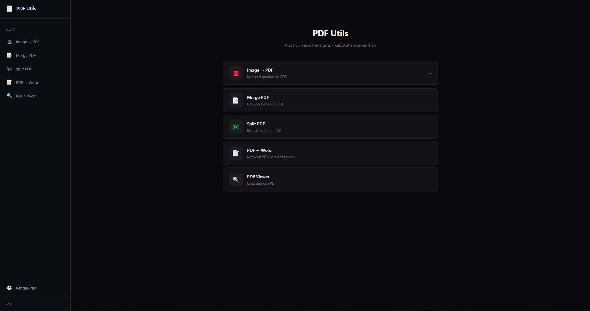

# 📄 PDF Utils

Aplikasi desktop modern, cepat, dan ringan untuk berbagai kebutuhan pengolahan dokumen PDF. Siap pakai langsung (*Zero-Configuration*) tanpa perlu instalasi pihak ketiga.

## ✨ Fitur

- 🖼️ **Image to PDF**: Gabungkan foto/gambar (PNG, JPG, WEBP, BMP) ke ukuran standar A4.
- 🔗 **Merge PDF**: Gabungkan beberapa file PDF menjadi satu dokumen berurutan.
- ✂️ **Split PDF**: Pratinjau visual thumbnail dan simpan halaman pilihan ke dokumen baru.
- 📸 **Ekstrak Gambar**: Pindai dokumen PDF, temukan seluruh elemen gambar, pratinjau resolusi, dan simpan gambar pilihan atau semua sekaligus.
- 📝 **PDF to Word (.docx)**: Konversi PDF ke Word yang dapat diedit dengan tata letak dan tabel presisi.
- 👁️ **PDF Viewer**: Penampil dokumen PDF bawaan dengan navigasi dan pencarian teks.
- 🌐 **Multi-bahasa**: Mendukung Bahasa Indonesia dan English dengan tema warna kustom.

## 📥 Download

Unduh versi terbaru untuk Windows di halaman [**Releases**](https://github.com/Eszuri/pdf-utils/releases):
- **Portable (`.exe`)**: Langsung jalankan tanpa instalasi.
- **Installer (`.msi`)**: Paket instalasi resmi Windows.

## 🛠️ Dibangun Dengan

- **Frontend**: React 19, TypeScript, Framer Motion, PDF.js
- **Backend**: Tauri v2, Rust
- **Engine**: PyMuPDF, python-docx

## 📜 Lisensi

[MIT License](LICENSE)
